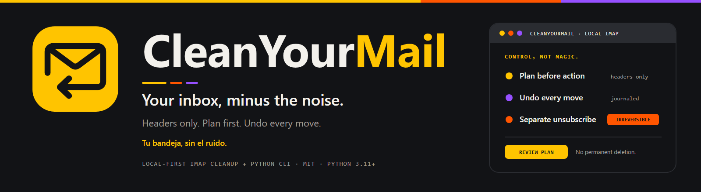

<p align="center">
  
</p>

# CleanYourMail — website

Static landing page for [CleanYourMail](https://github.com/jparedesDS/cleanyourmail), the
open-source, reversible inbox cleanup skill for coding agents.

**Live site:** <https://jparedesds.github.io/cleanyourmail-web/>  
**Spanish:** <https://jparedesds.github.io/cleanyourmail-web/es.html>

No framework, no build step, no external fonts, no analytics, no third-party requests.

## What is here

- A bilingual English/Spanish landing page with a terminal quick start and a provider grid.
- A compact CLI reference and copyable setup commands.
- A plain-language safety section: headers only, protected mail, no permanent deletion, undo.
- A short FAQ and clear calls to action.
- A strict Content Security Policy, `security.txt`, canonical URLs, hreflang alternates,
  Open Graph metadata, JSON-LD and a sitemap.
- Footer links to the repository, docs, security policy, discussions and the website source.

## Preview locally

```bash
python -m http.server 8080
```

Open <http://localhost:8080/>.

## Files

| Path | What it is |
|---|---|
| `index.html` | English landing page. |
| `es.html` | Spanish landing page. |
| `styles.css` | Shared styles. |
| `app.js` | Copy buttons and toast feedback. |
| `assets/logo.svg`, `assets/favicon.svg` | Brand mark. |
| `assets/banner.png` | Repository banner (1600×440). |
| `assets/og.png` | Social preview image (1280×640). |
| `assets/brand/` | Banner and social-preview directions explored for this update. |
| `robots.txt`, `sitemap.xml` | Crawler metadata. |
| `.well-known/security.txt` | Security contact and policy. |
| `404.html` | Not-found page. |
| `tests/test_site.py` | Link, ID, language, CSP, metadata and brand-asset checks. |

## Brand assets

The website uses the **dark editorial** direction (`assets/banner.png`). The skill repository uses
the terminal-first variant.

- `assets/brand/banner-web.png` — chosen for the website and this repository.
- `assets/brand/banner-skill.png` — chosen for the skill repository.
- `assets/brand/banner-light.png` — light “paper” alternate.
- `assets/brand/social-web.png`, `assets/brand/social-skill.png` — 1280×640 social previews.

## Release sync

`softwareVersion` in `index.html` and `es.html` must match `tools/cym_version.py` in the skill
repository. When the JSON-LD block changes, recompute the CSP `sha256` hash in both pages and run the
test suite again.

## Deploy

This repository is a static site at the root. In GitHub:

1. **Settings → Pages**.
2. **Build and deployment → Source**: **Deploy from a branch**.
3. Branch: **`main`**, folder: **`/ (root)`**.
4. Save.

If the first build does not start, push any commit to `main`. The `pages build and deployment`
workflow should appear in **Actions**.

No workflow is required. If you prefer GitHub Actions, add a Pages workflow that uploads the root
directory as the artifact.

## Tests

```bash
python -m unittest discover -s tests -v
```

The suite checks local links and assets, duplicate IDs, the language switch, analytics absence,
inline-style absence (CSP compatibility), the CSP hash against the JSON-LD block, third-party
requests, canonical/hreflang metadata, PNG dimensions, unrelated-project references and
`security.txt`.

## Links

- Skill repository: <https://github.com/jparedesDS/cleanyourmail>
- Discussions: <https://github.com/jparedesDS/cleanyourmail/discussions>
- Safety rules: <https://github.com/jparedesDS/cleanyourmail/blob/master/docs/SAFETY.md>
- Prompt: <https://github.com/jparedesDS/cleanyourmail/blob/master/PROMPT.md>
- Spanish prompt: <https://github.com/jparedesDS/cleanyourmail/blob/master/PROMPT.es.md>

## License

MIT. See [LICENSE](LICENSE).
